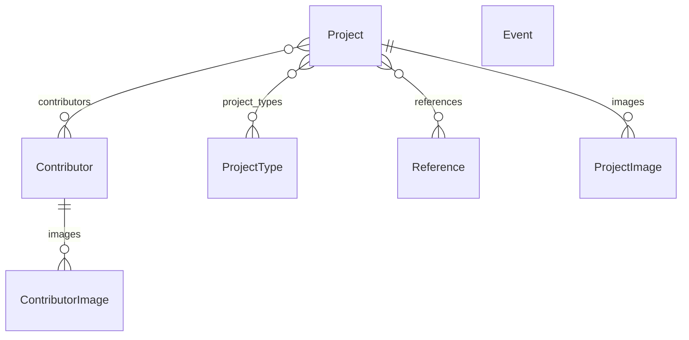

# HTS website

Sito del collettivo (Holistic Technology Salon): archivio dei progetti, contributor, eventi, pagina di
referenze/bibliografia e una pubblicazione statica su un sottodominio dedicato.

Stack: **Django 5.2**, **Postgres**, **WhiteNoise** per i file statici, **Gunicorn** per la produzione.
Il sito è **online su Railway**: <https://holistictechnologysalon.com>, con la pubblicazione su
<https://trifoldtrinetrinity.holistictechnologysalon.com> (vedi [Deploy](#deploy-su-railway)).

## Struttura del repository

```
HTS_website/
├── README.md
├── .gitignore
├── env/                          # virtualenv (non versionato)
└── hts_website/                  # radice del progetto Django (qui c'è manage.py)
    ├── manage.py
    ├── requirements.txt
    ├── .env                      # variabili d'ambiente locali (non versionato)
    ├── .env.example              # modello di .env, elenca le variabili richieste
    ├── hts_website/              # configurazione: settings.py, urls.py, wsgi.py
    ├── portfolio/                # l'unica app: modelli, view, admin, template, test
    │   ├── models.py             # dati (leggere prima il docstring in cima)
    │   ├── views.py              # una view per pagina, con docstring
    │   ├── urls.py               # indirizzi delle pagine
    │   ├── admin.py              # configurazione dell'admin
    │   ├── embeds.py             # da link YouTube/SoundCloud a indirizzi di embed (e validazione)
    │   ├── middleware.py         # serve la pubblicazione sul sottodominio
    │   ├── context_processors.py # rende PUBLICATION_URL disponibile ai template
    │   ├── templates/portfolio/  # base.html + una pagina per file
    │   ├── migrations/           # storia dello schema del database
    │   └── tests.py
    ├── publication/              # la pubblicazione statica (index.html + publication.css + images/)
    ├── static/                   # file statici del sito
    │   ├── css/custom.css        # lo stile personale, caricato dopo Bootstrap; in sezioni numerate [01]-[13], indice in cima
    │   ├── audio/intro.mp3       # suono dell'intro animato (15 s)
    │   ├── fonts/machina/        # Machina Inktrap con licenza (variable WOFF2, vedi Frontend)
    │   ├── js/                   # gallery.js (modale immagini), players.js (player), intro.js (intro animato)
    │   └── vendor/bootstrap/     # Bootstrap 5.3.8, copia locale (non si modifica)
    └── media/                    # immagini caricate dall'admin (non versionata)
```

## Avviare il sito in locale

Servono Python 3.11 e un server Postgres con un database vuoto (si può creare da pgAdmin 4).

```bash
# dalla radice del repository
python3.11 -m venv env            # solo la prima volta
source env/bin/activate
pip install -r hts_website/requirements.txt

cd hts_website
cp .env.example .env              # solo la prima volta, poi compilare i valori
python manage.py migrate          # crea le tabelle
python manage.py createsuperuser  # utente per entrare in /admin/
python manage.py runserver
```

- Sito: <http://localhost:8000> · Admin: <http://localhost:8000/admin/>
- Pubblicazione: <http://trifoldtrinetrinity.localhost:8000> (i sottodomini `*.localhost` funzionano senza configurare nulla)
- Per vedere il link "Publication" in navbar, nel `.env` imposta `PUBLICATION_URL=http://trifoldtrinetrinity.localhost:8000`

### Variabili d'ambiente

Vengono lette da `hts_website/.env` (in produzione dall'ambiente). Il modello è `.env.example`.

| Variabile | Obbligatoria | Significato |
|---|---|---|
| `SECRET_KEY` | sì | Chiave segreta di Django. Senza, il sito non parte. |
| `DEBUG` | no | `True` solo in sviluppo. Se manca vale `False`. |
| `PUBLICATION_URL` | no | Indirizzo della pubblicazione per il link in navbar. Vuoto = link nascosto. |
| `CONTACT_EMAIL` | no | Indirizzo e-mail di contatto, mostrato nel colophon di About (`mailto:`). Vuoto = la voce "Contact" non compare. |
| `PGDATABASE`, `PGUSER`, `PGPASSWORD`, `PGHOST`, `PGPORT` | sì | Connessione a Postgres. |

## Dati: come sono collegati



- **Project**: titolo, data, descrizione, una o più tipologie, contributor, immagini, e due link facoltativi
  (`youtube_url`, `soundcloud_url`) mostrati come player incorporati. `project_category` esiste
  ma oggi non è usata nelle pagine pubbliche (tenuta per il futuro).
- **ProjectType**: tipologie create dall'admin (es. "event", "radio show"). Una tipologia in uso non si può cancellare.
- **Contributor**: persone, con bio e immagini. I loro progetti si vedono nella pagina del contributor.
- **Reference**: voci della bibliografia (libro, video, immagine, link), opzionalmente collegate a progetti.
- **Event**: eventi, indipendenti dal resto. Futuro o passato si decide al volo confrontando la data con oggi.

Chi modifica cosa nell'admin (le relazioni many-to-many si modificano da **un solo lato**, l'altro è in sola lettura):

| Relazione | Si modifica da | Si vede (sola lettura) da |
|---|---|---|
| Project ↔ Contributor | admin del Project | admin del Contributor |
| Project ↔ Reference | admin della Reference | admin del Project |
| Project ↔ ProjectType | admin del Project | — |

## Pagine

| Indirizzo | View | Cosa fa |
|---|---|---|
| `/` | `home` | Home: il triskele a schermo intero, con l'intro animato sopra (se acceso). Ogni tracciato è un link a un progetto a caso di una categoria |
| `/archive/` | `project_list` | Archivio: tabella con ordinamento (`?sort=`) e filtro per tipologia (`?type=`) |
| `/archive/feed/` | `project_feed` | Tutti i progetti uno dopo l'altro, con i player YouTube/SoundCloud |
| `/archive/<id>/` | `project_detail` | Non ha pagina propria: reindirizza al feed, scrollato su quel progetto |
| `/archive/random/<categoria>/` | `random_project` | Reindirizza a un progetto a caso di quella categoria (`project_category`); se non ce ne sono, al feed. Categoria inesistente: 404. Mai in cache |
| `/contributors/`, `/contributors/<id>/` | `contributor_*` | Elenco e dettaglio dei contributor |
| `/agenda/` | `event_list` | Eventi futuri e passati in due sezioni (la pagina "Agenda" del menu; non è l'archivio dei progetti di tipo "event"). Prima era `/events/` |
| `/references/` | `reference_list` | Referenze, filtro per tipo (`?kind=`) |
| `/about/` | `about` | Pagina About: testo e colophon (elenco `<dl>` di crediti, a colonne, discreto: grigio e piccolo), scritti direttamente nel template `about.html`; stile in `custom.css`, sezione [14]. La voce "Contact" usa `CONTACT_EMAIL` |
| `trifoldtrinetrinity.<dominio>` | `PublicationMiddleware` | La pubblicazione statica (vedi sotto) |

## Frontend (Bootstrap)

Il sito usa **Bootstrap 5.3.8**, copiato in `hts_website/static/vendor/bootstrap/` invece di caricarlo da un CDN:
niente dipendenze esterne e nessun indirizzo IP dei visitatori inviato a terzi. Come aggiornarlo è scritto nel
README di quella cartella.

- **Dove si collega**: `templates/portfolio/base.html`, che tutte le pagine estendono. Carica prima il CSS di Bootstrap
  e poi `static/css/custom.css`; **l'ordine conta**, perché così le regole personali vincono. Il JavaScript di
  Bootstrap è in fondo alla pagina (serve alla navbar, che è sempre collassata dietro "Menu").
- **Struttura base**: navbar Bootstrap fissa in cima e sempre collassata (nessun `navbar-expand-*`: le voci si aprono in
  un menu "liquid glass" a tutta la viewport con dissolvenza in apertura e chiusura, sezione [04] di `custom.css`) e contenuto in un `<main class="container">`. Le pagine
  interne non usano ancora la griglia a colonne (`row`/`col-*`): è il lavoro di design da fare, pagina per pagina.
- **Come sovrascrivere Bootstrap**: le istruzioni sono in cima a `static/css/custom.css`. In breve: ridefinire le
  variabili `--bs-*` su `:root`, poi le variabili dei singoli componenti, poi regole normali; niente `!important`.
  Breakpoint e larghezze massime dei `.container` sono fissi nel file compilato: per cambiarli davvero servirebbe
  ricompilare Bootstrap con Sass, che oggi non è configurato (richiederebbe Node nel progetto).
- **I file statici**: in sviluppo li serve Django; in produzione `collectstatic` li raccoglie e li serve WhiteNoise.
  Si usano nei template con `` e ``.
- **Font**: **PP Neue Machina Inktrap, solo dritto, con licenza**, come **variable font**
  (`hts_website/static/fonts/machina/`, un solo WOFF2, asse `wght` 100–900): ogni peso intermedio è disponibile e si può
  animare. È l'unico carattere Machina: testo base (`--bs-body-font-family`) e titoli (`--hts-font-display`; Bootstrap non
  ha una variabile per i titoli, quindi c'è una regola su `h1…h6`). Il resto è in Alegreya. La `@font-face` è in cima a
  `custom.css` (e ripetuta in `publication.css`). Attenzione: il Regular del variable è a **375**, non 400 (Medium 450).
  Non esiste il corsivo: un `font-style: italic` su Inktrap viene inclinato dal browser (corsivo finto); si usa solo in
  pochi punti della pubblicazione (note dentro le citazioni, titoli nelle note, "holistic").
  In Inktrap mancano ▲ ▼ (frecce di ordinamento dell'archivio, oggi commentato): userebbero il carattere di riserva.
- **Tema scuro**: l'attributo `data-bs-theme="dark"` sul tag `<html>` fa cambiare a Bootstrap molte variabili insieme
  (colore del testo, icona della navbar, ecc.). Sta in `base.html` e anche nella pubblicazione.
- **La pubblicazione** ha uno stile tutto suo: `publication/publication.css`, che **non usa Bootstrap né `custom.css`**.
  Cambiare uno non tocca l'altro. Tutto ciò che si regola (colori, caratteri, corpi, larghezza della colonna, spazi, filetti)
  è in un blocco di variabili `--pub-...` in cima al file, a gruppi e commentate: per cambiare l'aspetto si cambiano
  i valori, le regole sotto non servono. In comune col sito restano solo il viola e il font Machina Inktrap (variable, con licenza): la sua
  `@font-face` è ripetuta in `publication.css` con percorso `/static/fonts/machina/...` (`/static/` è servito anche dal
  sottodominio). Il testo lungo è in Alegreya, caricata da Google Fonts nel `<head>` di `index.html` (con corsivo e
  grassetto veri: come per il sito, da scaricare in locale quando si autorizzerà).

## Cose non ovvie da sapere

**Archivio, ordinamento e filtro.** Sono nell'indirizzo (`?sort=-date&type=event`). La view accetta solo `title` e
`date` per l'ordinamento (lista bianca, perché il valore va in `order_by`). La colonna Type non è ordinabile perché
un progetto può avere più tipologie.

**`/archive/<id>/` e il feed.** Cliccando un progetto nell'archivio si va al feed già scrollato su di lui:
`project_detail` fa un redirect a `/archive/feed/#project-<id>` e il browser scrolla da solo all'elemento con
quell'`id`. Se cambi gli `id` nel template `_project.html`, rompi lo scroll.
Perché l'ancora atterri giusta, le immagini del feed devono avere `width` e `height` nell'``: sono `loading="lazy"`
e, senza dimensioni, occupano 0 px finché non si caricano, poi spingono in basso i progetti sotto (scarto diverso per
ogni progetto). `ProjectImage` salva le dimensioni da solo (`image_width`, `image_height`); per le immagini caricate
prima della migration 0014 si riempiono con `pi.save()` su ogni `ProjectImage`. Qualsiasi altro elemento di altezza
variabile messo nel feed (player, immagini) deve riservare il suo spazio allo stesso modo.

**Player YouTube e SoundCloud.** Nell'admin del progetto si incolla il link normale (quello della barra del browser
o di "Condividi"), mai codice HTML. `portfolio/embeds.py` riconosce il servizio, ricava l'indirizzo di embed e accetta
solo YouTube e SoundCloud: l'indirizzo finisce in un `<iframe>` e non deve poter puntare a un sito qualsiasi. I
player compaiono solo nel feed dei progetti (`_project.html`, incluso da `project_feed.html`) e sono custom:
comportamento in `static/js/players.js`, aspetto in `custom.css` (sezione [09]).

- **YouTube**: finché non si preme play c'è solo una copertina (`hqdefault.jpg` da `i.ytimg.com`, indirizzo da
  `youtube_thumbnail_url`) con un'etichetta "Play"; nessun iframe e nessuno script di Google. Al clic `players.js` crea
  l'`<iframe>` da `data-embed-url` con `autoplay=1`. Senza JavaScript la copertina è un normale link al video. I parametri
  in `YOUTUBE_PARAMS` (`embeds.py`) valgono ancora, dopo il clic. Per YouTube si usa `youtube-nocookie.com`.
- **SoundCloud**: il widget ufficiale è un iframe nascosto (`.sc-engine`) che fa solo da motore audio; play/pausa, barra
  e tempo sono nostri e lo pilotano con la Widget API (`https://w.soundcloud.com/player/api.js`, caricata da `players.js`
  solo se nella pagina c'è un player). Titolo e artista arrivano dal widget: sono l'attribuzione richiesta da SoundCloud,
  non vanno tolti. Il widget si carica solo quando il player sta per entrare nello schermo e un solo brano suona alla volta.
  Il widget di SoundCloud può impostare cookie già al caricamento: se il sito avrà un banner di consenso, va considerato.
  Dei parametri di `SOUNDCLOUD_PARAMS` oggi conta poco: l'interfaccia ufficiale non si vede.
- **Da verificare su iPhone**: Safari iOS può rifiutare il `play()` dato da JavaScript al widget di SoundCloud (gli serve
  un gesto dentro l'iframe). Provato solo su desktop.

**Triskele della home.** La home mostra il triskele (`home.html`, disegno in `_triskele.html`, condiviso con l'intro): stesso
disegno, stessa posizione (centro dello schermo) e stessa dimensione (`--hts-triskele-size` in `custom.css`) di quello dell'intro, così
quando l'intro si dissolve si vede lo stesso disegno senza salti. Ogni tracciato è un link a `/archive/random/<categoria>/`:
tracciato 1 (in alto) = **relationality**, 2 (in basso a sinistra) = **perception**, 3 (in basso a destra) = **cognition**.
La categoria è il campo `project_category` del progetto, che si imposta dall'admin (valori: `relationality`, `perception`, `cognition`).
Attorno alle spirali c'è un **cerchio**, anche lui link (il quarto, `triskele-link-4` di `_triskele.html`, con lo stesso bagliore e un nome
sotto): porta alla pubblicazione (`PUBLICATION_URL`; se non è impostata il cerchio non compare). Prima c'era un perimetro disegnato
su misura (nell'`Asset 1.svg`): il cliente ha preferito un cerchio, che è un `<circle>` e non fa parte del disegno. È centrato sul centro di simmetria
delle tre spirali (`cx 225,1`, `cy 241,3`) con raggio 222 (le spirali arrivano a 196: restano circa 25 di margine); il `viewBox` è quadrato e centrato su
di lui (`-1,4 14,8 453 453`), così cerchio e spirali stanno al centro dello schermo, nell'intro come nella home. Il clic lo riceve solo lungo la linea
(`--home-triskele-hit-width`), non dentro. **Il disegno** delle spirali è `Asset 1.svg` (linee sottili di 3 unità: `--home-triskele-width`,
`--intro-line-width`): ogni spirale è un **nastro disegnato come contorno**, cioè
un solo tracciato a doppia linea (parte da una giunzione, scende al centro lungo un bordo e torna fuori dall'altro). Per questo mouse e clic sulle
spirali li riceve un **disco pieno** (un `<circle>` trasparente per spirale, in `_triskele.html`: centro `cx, cy` e raggio 100) che le copre tutte, spazi tra
un giro e l'altro compresi: con le sole linee, o con il solo nastro, il mouse uscirebbe e rientrerebbe di continuo e l'hover sfarfallerebbe. Se si cambia il disegno vanno
rimisurati i `data-center` (vedi sotto), il centro e il raggio dei dischi e del cerchio e il `viewBox` (il nome sotto il triskele parte da metà dimensione, `.home-triskele-label` in `custom.css`).
- **Una volta per sessione del browser** (`sessionStorage`, chiave `htsIntroSeen`), e **mai** con "riduci movimento" attivo.
  Il tasto **Skip** (o Esc) lo chiude subito e ferma l'audio. Mentre dura, il resto della pagina non è cliccabile (`inert`).
- **Dove sta**: markup in `portfolio/_intro.html` (il triskele è `_triskele.html` con `pathLength="1"`: si disegna con
  `stroke-dasharray`/`stroke-dashoffset`, come il trim paths di After Effects; nell'intro ci sono solo le tre spirali, senza il cerchio. Ogni spirale
  è un nastro a doppia linea e **cresce dal centro verso entrambe le estremità**, con i due bordi insieme (le due metà, di lunghezza diversa, si completano nello stesso istante): il punto del giro al centro è `data-center`
  sul tracciato, la frazione della sua lunghezza misurata sul disegno (punto di massima curvatura); l'ordine resta in alto, in basso a sinistra,
  in basso a destra), comportamento e **tempi** in `static/js/intro.js` (oggetto
  `TIMELINE` in cima), aspetto in `custom.css` (sezione [13]: colori, spessore, dimensioni, in variabili `--intro-...`).
  Lo sfondo è **liquido**: uno shader WebGL a schermo intero (`<canvas class="intro-liquid">`, `static/js/intro-liquid.js`) con rumore
  simplex che scorre piano, ispirato al pen "Liquid Rainbow" di Johan Karlsson, ma con colori nero → accento → bianco al posto
  dell'arcobaleno. Si regola con le variabili `--intro-liquid-...` in `custom.css` (sezione [13]): `-dark`, `-mid` (il viola),
  `-light`, `-white` (quanto bianco), `-speed`, `-scale`, `-resolution`, `-opacity`. Senza WebGL resta il nero. Le immagini
  `static/img/tv-static*.png|jpg` della vecchia TV static non sono più usate.
  **Due versioni dello sfondo** (si cambia in `_intro.html` con la classe `intro-glow` sul `<div class="intro">`): con la classe,
  sfondo nero e il testo d'ingresso che pulsa con l'alone `--hts-glow` (variabili `--intro-glow-duration` e `--intro-glow-min`
  in `custom.css`); senza la classe, lo sfondo liquido.
- **Rete di sicurezza**: senza JavaScript lo strato non compare; se `intro.js` non parte, sparisce da solo dopo 4 secondi.
- **Audio**: "Dial Up Internet Sound" di Free Sounds Library (https://www.freesoundslibrary.com/dial-up-internet-sound/),
  licenza **CC BY 4.0**, ritagliato a 15 s (l'originale dura 24 s) e rinominato `static/audio/intro.mp3`. La licenza chiede
  l'attribuzione: è nei crediti della pagina About ("Intro Sound", con link alla fonte e alla licenza e la nota "edited").
  Se si cambia l'audio, va aggiornato anche quel credito. La durata dell'intro non dipende dal file: si regola con `TIMELINE.duration`.
- Non provato su iPhone/Safari: lì il comportamento dell'audio è il più delicato.

**Cancellare una tipologia.** Per una many-to-many Django non ha `on_delete=PROTECT`: senza protezione
cancellerebbe in silenzio i collegamenti con i progetti. Per questo `ProjectTypeAdmin` (in `admin.py`) elenca i
progetti collegati come "protetti" e non mostra il pulsante di conferma. Funziona dall'admin, non da `manage.py shell`.

**La pubblicazione sul sottodominio.** `PublicationMiddleware` guarda l'host della richiesta: se inizia per
`trifoldtrinetrinity.` serve i file di `hts_website/publication/` (con `index.html` per le cartelle) e risponde 404 a tutto il
resto, `/admin/` compreso. Per gli altri host non fa nulla. Con `DEBUG=True` le modifiche ai file si vedono subito;
in produzione l'elenco dei file è fissato all'avvio, quindi dopo ogni modifica serve un nuovo deploy.
La pubblicazione è una pagina unica: titolo, indice e un `<article id="...">` per ogni testo (Introduction, How to
Read, i saggi, le opere, Acknowledgements), con link ad ancore (`#slug`). Il contenuto è la conversione della versione
finale (`FINAL_epub.md`, non nel repository): da ora `index.html` si modifica a mano. **Le note**: il numero in apice nel testo (classe `pub-fnref`) apre e chiude la nota (`<span class="pub-note" id="fn-AUTORE-N">`),
che sta dentro il paragrafo subito dopo il numero (e dopo la virgola o il punto che lo segue) ed è in grigio; il comportamento è in `publication/publication.js`
(`aria-expanded`, e un indirizzo `#fn-AUTORE-N` apre la nota), l'aspetto nei valori `--pub-note-*` di `publication.css`.
Senza JavaScript le note restano sempre visibili.
**Barra in alto e indice**: con JavaScript compare una barra fissa (`.pub-topbar`): a sinistra il marchio HTS (porta al sito principale:
`publication.js` ne ricava l'indirizzo togliendo "trifoldtrinetrinity." dall'host), al centro il nome del testo in cui si è e il suo
autore, a destra il pulsante "Contents" che apre l'indice a tutto schermo (solo sotto i 1024px: da lì in su c'è la barra laterale) (`.pub-menu`, con sfondo nero pieno e dissolvenza come il menu
del sito; si chiude con lo stesso pulsante, con Esc o scegliendo una voce). Nome e autore vengono da `data-title` e
`data-author` di ogni `<article>` in `index.html`: per correggerli basta cambiare quegli attributi; i valori
`--pub-topbar-*` e `--pub-menu-*` in `publication.css` regolano l'aspetto. Senza JavaScript resta l'indice in pagina.
Nella tavola iniziale, passando con il mouse sul titolo di un capitolo le sue voci (sottocapitoli, sotto-sottocapitoli e numeri) si schiariscono del
`--pub-toc-hover-lighten` (50%: il loro grigio mescolato al bianco); le voci sono raggruppate per capitolo (`li.pub-toc-group`).
**Indice e barra dei numeri**: la tavola dei contenuti iniziale (`<nav class="pub-toc">`) è "a tabulazioni", come in InDesign: elenco
piatto con il numero a sinistra e il titolo che comincia alla prima tabulazione (capitoli) o alla seconda (sottotitoli e
sotto-sottotitoli), con le righe a capo allineate al titolo; le tabulazioni e gli spazi sono i valori `--pub-toc-*` in
`publication.css`. L'indice a tutto schermo (sotto i 1024px) usa la stessa tavola a tabulazioni, con la voce del testo corrente in viola (`.pub-contents`, l'elenco con i rientri, non è più usato). In entrambi sono link solo i
titoli dei testi (h2); i sottotitoli sono testo semplice. Ogni voce ha un numero (1, 1.1, 1.1.1), calcolato da `index.html` nell'ordine dei titoli. Per
saltare a un sottocapitolo c'è la barra laterale (`<nav class="pub-sidebar">`): un elenco piatto, senza rientri, con solo i
numeri (ognuno è un link), fissa a sinistra dai 1024px in su. Compare solo dal primo capitolo in poi (non sulla copertina né
sull'indice iniziale), con una freccia → davanti al numero della sezione corrente (`--pub-sidebar-arrow`), e al passaggio del mouse mostra il nome del titolo
(`data-title`): tutto questo lo fa `publication.js`, quindi senza JavaScript la barra non compare. La barra scorre da sola per tenere in vista il numero corrente, ma non mentre la pagina scorre per un clic su un suo numero (si ricentra solo dopo). Se cambi, aggiungi o togli un titolo, vanno rinumerati a mano la voce dell'indice e quella
della barra (i valori `--pub-sidebar-*` e `--pub-num-color` in `publication.css` ne regolano l'aspetto).
Le bibliografie sono `<ul class="works-cited">`. Il titolo "Introduction"
del primo articolo non c'è nel markdown: serve all'indice. Le immagini stanno in `publication/images/` (20 file,
`image1` … `image20`, con le didascalie in `<figcaption>`; `alt` è vuoto dove il markdown non aveva didascalia). Hanno il **bordo sfumato** delle foto del sito principale (maschera con due sfumature intersecate); la larghezza è `--pub-image-fade` in `publication.css` (0 = nessuna). Ogni immagine porta in `style` i suoi pixel naturali (`--pub-img-w`, `--pub-img-h`): il CSS riserva così lo spazio giusto prima che si carichi (`loading="lazy"`), altrimenti il testo sotto si sposterebbe e le ancore della barra laterale finirebbero nel posto sbagliato. Chi aggiunge un'immagine a mano deve metterli anche lì.

**Immagini caricate.** Finiscono in `hts_website/media/`, cartella ignorata da git: chi clona il repository non le
riceve, e se servono vanno salvate a parte. In sviluppo le serve Django; online stanno su Cloudflare R2.
Il sito non le ridimensiona: miniature e galleria scaricano il file caricato, quindi vanno preparate prima (lato lungo
2000 px, ritratti e referenze 1200 px, JPG qualità 80 circa, meglio sotto i 500 KB e mai oltre 1 MB).

**Migration scritte a mano.** `0009_copy_project_type_to_project_types.py` è una migration dei dati, commentata:
fa parte della sequenza 0008-0010 che ha sostituito il vecchio campo `project_type` con la many-to-many.

**Refuso nelle categorie (corretto).** In `Project.CATEGORIES` la terza categoria era scritta `"cogniton"`; ora è `"cognition"`.
Le migrazioni `0020` (scelte del campo) e `0021` (aggiorna i progetti già salvati con il vecchio valore, reversibile) lo correggono su qualsiasi database.

## Operazioni comuni

```bash
# dopo aver modificato models.py
python manage.py makemigrations
python manage.py migrate

# test (crea e poi cancella un database temporaneo test_<nome>)
python manage.py test portfolio

# controllo rapido della configurazione
python manage.py check
```

- **Aggiungere una tipologia di progetto**: admin → Project types (lo slug si compila da solo).
- **Aggiornare la pubblicazione**: modifica `hts_website/publication/index.html` (istruzioni in un commento in cima al file); per l'aspetto, i valori in cima a `publication/publication.css`.
- **Cambiare il nome di una pagina in `urls.py`**: aggiorna anche i `` nei template che lo usano.

## Deploy su Railway

La configurazione sta in `hts_website/railway.json` (comandi di avvio), nelle impostazioni lette dall'ambiente
(`settings.py`) e nel file `.python-version`. Se dopo un cambio i comandi non risultano in Settings del servizio ->
Deploy, vanno incollati a mano (sono quelli del file). Per pubblicare una modifica: commit e `git push`.

**Cosa succede a ogni deploy.** Prima di avviare la nuova versione: `python manage.py migrate --noinput` (aggiorna il
database; crea anche il gruppo *Authors*) e `python manage.py ensure_superuser` (crea il superuser dalle variabili
d'ambiente se non esiste; se esiste non tocca nulla). Avvio: `collectstatic` e Gunicorn.

**File statici.** Online hanno un'impronta nel nome (`CompressedManifestStaticFilesStorage`) e i browser li tengono in
cache a lungo: una modifica a CSS o JavaScript si vede subito dopo il deploy. Nei template usare sempre ``.
Se un CSS cita un file che non esiste, `collectstatic` si ferma e il deploy non parte. La pubblicazione (HTML, CSS, JS e
immagini) e il font che il suo CSS richiama per percorso fisso restano in cache 60 secondi.

**Variabili d'ambiente del servizio web** (Railway -> servizio -> Variables):

| Variabile | Valore |
|---|---|
| `SECRET_KEY` | stringa lunga e casuale (`python -c "import secrets; print(secrets.token_urlsafe(50))"`) |
| `PGHOST`, `PGPORT`, `PGUSER`, `PGPASSWORD`, `PGDATABASE` | riferimenti al servizio Postgres di Railway: `${{Postgres.PGHOST}}` ecc. |
| `NOINDEX` | `True` = i motori di ricerca non indicizzano il sito. Per farlo trovare: togliere la variabile (o `False`) |
| `SECURE_HSTS_SECONDS` | HSTS in secondi (manca = spento): vedi sotto |
| `CONTACT_EMAIL` | indirizzo mostrato nella pagina About; manca = la voce "Contact" non compare |
| `R2_BUCKET_NAME`, `R2_ACCOUNT_ID`, `R2_ACCESS_KEY_ID`, `R2_SECRET_ACCESS_KEY`, `R2_PUBLIC_DOMAIN` | storage delle immagini (vedi sotto) |
| `DJANGO_SUPERUSER_USERNAME`, `DJANGO_SUPERUSER_PASSWORD`, `DJANGO_SUPERUSER_EMAIL` | il tuo account admin. Dopo il primo deploy la password si cambia dall'admin; quella nella variabile non serve più |
| `DEBUG` | **non impostarla** (vale False) |
| `ALLOWED_HOSTS` | `holistictechnologysalon.com,trifoldtrinetrinity.holistictechnologysalon.com` (senza, con il dominio proprio ogni pagina risponde 400) |
| `PUBLICATION_URL` | `https://trifoldtrinetrinity.holistictechnologysalon.com` (vuota = link "Publication" nascosto) |

**Rifare il deploy da zero, in ordine**
1. **GitHub**: pubblicare i commit (`git push`). Il repository non contiene segreti.
2. **Cloudflare R2** (immagini): R2 -> Create bucket -> nel bucket Settings -> attivare l'accesso pubblico (dominio `r2.dev`, che diventa
   `R2_PUBLIC_DOMAIN`, senza `https://`) -> "Manage R2 API tokens" -> Create token con permesso *Object Read & Write* sul solo bucket.
   Si ottengono Account ID, Access Key ID e Secret Access Key. Il bucket ha un CORS di default che basta (le immagini si caricano dall'admin sul server, non dal browser).
3. **Railway**: New Project -> Deploy from GitHub repo -> servizio -> Settings -> **Root Directory: `hts_website`**. Add -> Database -> PostgreSQL.
   Inserire le variabili della tabella sopra. Settings -> Networking -> **Generate Domain** (indirizzo `*.up.railway.app`) e rifare il deploy:
   fino ad allora il sito risponde 400 perché non conosce il proprio indirizzo.
4. **Primo accesso**: `https://<indirizzo>/admin/` con le credenziali delle variabili. In *Site settings* si accende o spegne l'intro
   animato (su un database nuovo parte **spento**: va acceso a mano).
5. **Autori**: Users -> Add user (nome e password), poi nella scheda dell'utente spuntare **Staff status** e aggiungerlo al gruppo **Authors**.
   Gli autori gestiscono progetti, contributor, eventi, referenze, tipologie e immagini; non vedono utenti, gruppi né Site settings.
   **Mai** spuntare "Superuser status" agli autori.

**Cose da sapere**
- **Database online = quello vero.** Non si copia sopra il database locale (contiene dati di prova). Le migrazioni si applicano a ogni deploy:
  conviene che le modifiche ai modelli siano *additive* (aggiungere campi con valore predefinito o facoltativi); per rinominare o togliere un campo, prima un backup.
- **Immagini**: finiscono su R2 e non si perdono ai deploy. Senza le variabili `R2_*`, online le immagini non si vedrebbero (con DEBUG spento Django non serve `media/`).
  Le immagini nel `media/` locale non vengono caricate online.
- **Domini**: in Railway sono collegati il dominio principale e `trifoldtrinetrinity.<dominio>` (record DNS su Cloudflare in
  "DNS only"). Il piano attuale non ne ammette altri: `www` si gestisce solo in Cloudflare (record `A` `www` -> `192.0.2.1`
  con proxy attivo, più una Redirect Rule da `www` al dominio principale).
- **HSTS**: si accende con `SECURE_HSTS_SECONDS`, prima `3600` (un'ora); se per qualche giorno va tutto bene, `2592000`
  (30 giorni) e poi `31536000` (un anno). I browser ricordano il valore per tutta la durata: per tornare indietro si mette
  `0` e si aspetta. `check --deploy` continua a segnalare `includeSubDomains` e `preload`, spenti apposta.
- **Backup**: il database viene copiato ogni notte su R2, vedi [Backup del database](#backup-del-database). Le immagini non
  sono nel database (stanno su R2).

### Backup del database

`.github/workflows/db-backup.yml` (GitHub Actions) ogni notte esporta il Postgres di Railway con `pg_dump` e carica il file
in `db/` su un bucket R2 dedicato. Non resta nessuna copia sul computer.

**Configurazione (una volta)**
1. Cloudflare -> R2 -> Create bucket (es. `hts-backups`), **senza accesso pubblico**: il file contiene anche gli utenti.
   Mai usare il bucket delle immagini, che è pubblico.
2. Nel bucket: Settings -> Object lifecycle rules -> cancellare gli oggetti dopo 30 giorni (limita spazio e costo).
3. R2 -> Manage R2 API tokens -> Create token, *Object Read & Write* sul solo bucket dei backup.
4. Railway -> servizio Postgres -> Variables: copiare `DATABASE_PUBLIC_URL` (richiede l'accesso pubblico del database,
   Settings -> Networking; il traffico in uscita può essere conteggiato nei consumi di Railway).
5. GitHub -> repository -> Settings -> Secrets and variables -> Actions -> New repository secret, uno per nome:
   `DATABASE_PUBLIC_URL`, `BACKUP_R2_ACCOUNT_ID`, `BACKUP_R2_ACCESS_KEY_ID`, `BACKUP_R2_SECRET_ACCESS_KEY`,
   `BACKUP_R2_BUCKET_NAME`.
6. Dopo il push: Actions -> Backup database -> **Run workflow**, e controllare che il file compaia nel bucket.

**Da sapere.** Se un backup fallisce GitHub avvisa per e-mail (secondo le impostazioni di notifica): controllare ogni tanto
che nel bucket ci siano file recenti. In un repository pubblico GitHub sospende le esecuzioni pianificate dopo 60 giorni
senza attività. Se Railway passa a un Postgres più recente di quello in `PG_IMAGE`, aggiornare la riga nel workflow. Se la
password del database cambia, aggiornare il secret.

**Ripristino.** Scaricare il file dal bucket ed eseguire `pg_restore --clean --if-exists --no-owner -d "<indirizzo>" file.dump`:
**sovrascrive** il database indicato, quindi provarlo prima su un database vuoto.

**Da fare**
- [ ] Impostare `SECURE_HSTS_SECONDS` e alzarlo per gradi.
- [ ] Spegnere `NOINDEX`.
- [ ] Configurare il redirect di `www` in Cloudflare.
- [ ] Configurare il backup (bucket, secrets) e provare un ripristino.
- [ ] Alleggerire le immagini già caricate.
- [ ] Valutare un dominio proprio per le immagini (es. `media.<dominio>`) al posto di `r2.dev`: se cambia, `R2_PUBLIC_DOMAIN` si aggiorna, ma gli indirizzi delle immagini già salvate restano quelli vecchi se il bucket resta lo stesso.

## Idee rimandate

- **Design**: layout editoriale, colori e tipografia da definire in `static/css/custom.css`, adattando le pagine alla
  griglia di Bootstrap. Restano alcuni `style=` inline temporanei (larghezza immagini, margini) e le classi `active`
  dei filtri non hanno ancora uno stile.
- **Zotero** per la bibliografia: valutato e per ora scartato; le referenze si inseriscono dall'admin.
- **Video incorporati** (YouTube/Vimeo) nelle referenze: oggi i video sono solo un link.
- **Dati di prova**: il database locale contiene referenze di esempio e la pubblicazione contiene testi fittizi.
