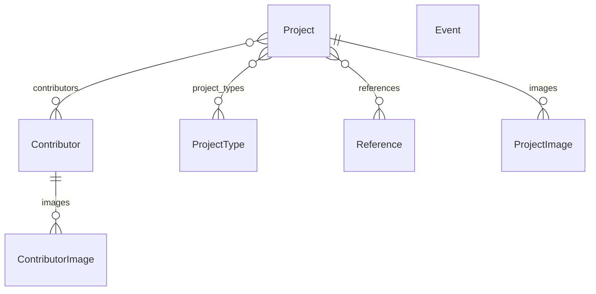

# HTS website

Sito del collettivo (Holistic Technology Salon): archivio dei progetti, contributor, eventi, pagina di
referenze/bibliografia e una pubblicazione statica su un sottodominio dedicato.

Stack: **Django 5.2**, **Postgres**, **WhiteNoise** per i file statici, **Gunicorn** per la produzione.
Il deploy previsto è su **Railway** (non ancora fatto, vedi [Deploy](#deploy-checklist)).

> Stato attuale: Bootstrap è collegato e la navbar è responsive, ma il design vero (layout editoriale, colori,
> tipografia) è ancora da fare: le pagine hanno l'aspetto di base di Bootstrap. Vedi [Frontend](#frontend-bootstrap).

## Struttura del repository

```
HTS_website/
├── README.md
├── .gitignore
├── env/                          # virtualenv (non versionato)
└── hts_website/                  # radice del progetto Django (qui c'è manage.py)
    ├── manage.py
    ├── requirements.txt
    ├── .env                      # variabili d'ambiente locali (non versionato)
    ├── .env.example              # modello di .env, elenca le variabili richieste
    ├── hts_website/              # configurazione: settings.py, urls.py, wsgi.py
    ├── portfolio/                # l'unica app: modelli, view, admin, template, test
    │   ├── models.py             # dati (leggere prima il docstring in cima)
    │   ├── views.py              # una view per pagina, con docstring
    │   ├── urls.py               # indirizzi delle pagine
    │   ├── admin.py              # configurazione dell'admin
    │   ├── middleware.py         # serve la pubblicazione sul sottodominio
    │   ├── context_processors.py # rende PUBLICATION_URL disponibile ai template
    │   ├── templates/portfolio/  # base.html + una pagina per file
    │   ├── migrations/           # storia dello schema del database
    │   └── tests.py
    ├── publication/              # la pubblicazione statica (HTML + images/)
    ├── static/                   # file statici del sito
    │   ├── css/custom.css        # lo stile personale, caricato dopo Bootstrap
    │   ├── fonts/trial/          # font in versione trial (ignorata da git, vedi Frontend)
    │   └── vendor/bootstrap/     # Bootstrap 5.3.8, copia locale (non si modifica)
    └── media/                    # immagini caricate dall'admin (non versionata)
```

## Avviare il sito in locale

Servono Python 3.11 e un server Postgres con un database vuoto (si può creare da pgAdmin 4).

```bash
# dalla radice del repository
python3.11 -m venv env            # solo la prima volta
source env/bin/activate
pip install -r hts_website/requirements.txt

cd hts_website
cp .env.example .env              # solo la prima volta, poi compilare i valori
python manage.py migrate          # crea le tabelle
python manage.py createsuperuser  # utente per entrare in /admin/
python manage.py runserver
```

- Sito: <http://localhost:8000> · Admin: <http://localhost:8000/admin/>
- Pubblicazione: <http://publication.localhost:8000> (i sottodomini `*.localhost` funzionano senza configurare nulla)
- Per vedere il link "Publication" in navbar, nel `.env` imposta `PUBLICATION_URL=http://publication.localhost:8000`

### Variabili d'ambiente

Vengono lette da `hts_website/.env` (in produzione dall'ambiente). Il modello è `.env.example`.

| Variabile | Obbligatoria | Significato |
|---|---|---|
| `SECRET_KEY` | sì | Chiave segreta di Django. Senza, il sito non parte. |
| `DEBUG` | no | `True` solo in sviluppo. Se manca vale `False`. |
| `PUBLICATION_URL` | no | Indirizzo della pubblicazione per il link in navbar. Vuoto = link nascosto. |
| `PGDATABASE`, `PGUSER`, `PGPASSWORD`, `PGHOST`, `PGPORT` | sì | Connessione a Postgres. |

## Dati: come sono collegati



- **Project**: titolo, data, descrizione, una o più tipologie, contributor, immagini. `project_category` esiste
  ma oggi non è usata nelle pagine pubbliche (tenuta per il futuro).
- **ProjectType**: tipologie create dall'admin (es. "event", "radio show"). Una tipologia in uso non si può cancellare.
- **Contributor**: persone, con bio e immagini. I loro progetti si vedono nella pagina del contributor.
- **Reference**: voci della bibliografia (libro, video, immagine, link), opzionalmente collegate a progetti.
- **Event**: eventi, indipendenti dal resto. Futuro o passato si decide al volo confrontando la data con oggi.

Chi modifica cosa nell'admin (le relazioni many-to-many si modificano da **un solo lato**, l'altro è in sola lettura):

| Relazione | Si modifica da | Si vede (sola lettura) da |
|---|---|---|
| Project ↔ Contributor | admin del Project | admin del Contributor |
| Project ↔ Reference | admin della Reference | admin del Project |
| Project ↔ ProjectType | admin del Project | — |

## Pagine

| Indirizzo | View | Cosa fa |
|---|---|---|
| `/` | `home` | Home (vuota per ora) |
| `/projects/` | `project_list` | Archivio: tabella con ordinamento (`?sort=`) e filtro per tipologia (`?type=`) |
| `/projects/feed/` | `project_feed` | Tutti i progetti uno dopo l'altro |
| `/projects/<id>/` | `project_detail` | Non ha pagina propria: reindirizza al feed, scrollato su quel progetto |
| `/contributors/`, `/contributors/<id>/` | `contributor_*` | Elenco e dettaglio dei contributor |
| `/events/` | `event_list` | Eventi futuri e passati in due sezioni |
| `/references/` | `reference_list` | Referenze, filtro per tipo (`?kind=`) |
| `/about/` | `about` | Pagina About (testo scritto direttamente nel template `about.html`) |
| `publication.<dominio>` | `PublicationMiddleware` | La pubblicazione statica (vedi sotto) |

## Frontend (Bootstrap)

Il sito usa **Bootstrap 5.3.8**, copiato in `hts_website/static/vendor/bootstrap/` invece di caricarlo da un CDN:
niente dipendenze esterne e nessun indirizzo IP dei visitatori inviato a terzi. Come aggiornarlo è scritto nel
README di quella cartella.

- **Dove si collega**: `templates/portfolio/base.html`, che tutte le pagine estendono. Carica prima il CSS di Bootstrap
  e poi `static/css/custom.css`; **l'ordine conta**, perché così le regole personali vincono. Il JavaScript di
  Bootstrap è in fondo alla pagina (serve alla navbar che si chiude su schermi stretti).
- **Struttura base**: navbar Bootstrap (`navbar-expand-lg`) e contenuto in un `<main class="container">`. Le pagine
  interne non usano ancora la griglia a colonne (`row`/`col-*`): è il lavoro di design da fare, pagina per pagina.
- **Come sovrascrivere Bootstrap**: le istruzioni sono in cima a `static/css/custom.css`. In breve: ridefinire le
  variabili `--bs-*` su `:root`, poi le variabili dei singoli componenti, poi regole normali; niente `!important`.
  Breakpoint e larghezze massime dei `.container` sono fissi nel file compilato: per cambiarli davvero servirebbe
  ricompilare Bootstrap con Sass, che oggi non è configurato (richiederebbe Node nel progetto).
- **I file statici**: in sviluppo li serve Django; in produzione `collectstatic` li raccoglie e li serve WhiteNoise.
  Si usano nei template con `` e ``.
- **Font**: PP Neue Machina in versione **trial**, in `hts_website/static/fonts/trial/` (12 file OTF: famiglie
  Plain e Inktrap, ciascuna in Light/Regular/Ultrabold con i corsivi). La cartella è nel `.gitignore` perché la
  licenza di prova non permette di distribuire i file: **chi clona il repository, o il sito pubblicato, non li ha**
  e vede il carattere di riserva (`sans-serif`). Le `@font-face` sono in cima a `custom.css`: "Machina Plain" per
  il testo (`--bs-body-font-family`) e "Machina Inktrap" per i titoli (Bootstrap non ha una variabile per i titoli,
  quindi c'è una regola su `h1…h6`). Nel trial mancano solo ▲ ▼ (frecce di ordinamento): usano il carattere di riserva.
  **Con la licenza**: mettere i file (meglio WOFF2, se la licenza permette la conversione) in `static/fonts/`,
  aggiornare gli `url()` in `custom.css` e togliere la riga dal `.gitignore` solo se la licenza consente di versionarli
  (in un repository pubblico di solito no).
- **Tema scuro**: l'attributo `data-bs-theme="dark"` sul tag `<html>` fa cambiare a Bootstrap molte variabili insieme
  (colore del testo, icona della navbar, ecc.). Sta in `base.html` e anche nella pubblicazione.
- **La pubblicazione** usa gli stessi file (Bootstrap + `custom.css`), collegati dal suo `<head>` con percorsi
  `/static/...`: quell'indirizzo è servito anche dal sottodominio. Quindi **cambiare `custom.css` cambia lo stile di
  entrambi i siti**. I percorsi devono coincidere con `STATIC_URL`: se in produzione i file statici passassero da
  un altro indirizzo, vanno aggiornati anche in `publication/index.html`. La pubblicazione non carica il JavaScript
  di Bootstrap (non ha navbar).

## Cose non ovvie da sapere

**Archivio, ordinamento e filtro.** Sono nell'indirizzo (`?sort=-date&type=event`). La view accetta solo `title` e
`date` per l'ordinamento (lista bianca, perché il valore va in `order_by`). La colonna Type non è ordinabile perché
un progetto può avere più tipologie.

**`/projects/<id>/` e il feed.** Cliccando un progetto nell'archivio si va al feed già scrollato su di lui:
`project_detail` fa un redirect a `/projects/feed/#project-<id>` e il browser scrolla da solo all'elemento con
quell'`id`. Se cambi gli `id` nel template `project_feed.html`, rompi lo scroll.

**Cancellare una tipologia.** Per una many-to-many Django non ha `on_delete=PROTECT`: senza protezione
cancellerebbe in silenzio i collegamenti con i progetti. Per questo `ProjectTypeAdmin` (in `admin.py`) elenca i
progetti collegati come "protetti" e non mostra il pulsante di conferma. Funziona dall'admin, non da `manage.py shell`.

**La pubblicazione sul sottodominio.** `PublicationMiddleware` guarda l'host della richiesta: se inizia per
`publication.` serve i file di `hts_website/publication/` (con `index.html` per le cartelle) e risponde 404 a tutto il
resto, `/admin/` compreso. Per gli altri host non fa nulla. Con `DEBUG=True` le modifiche ai file si vedono subito;
in produzione l'elenco dei file è fissato all'avvio, quindi dopo ogni modifica serve un nuovo deploy.
La pubblicazione è una pagina unica: introduzione, indice, contributi uno dopo l'altro e una bibliografia unica in
fondo (`#bibliography`, in ordine alfabetico per cognome), con link ad ancore (`#slug`). **Il contenuto attuale è
fittizio**, da sostituire: la bibliografia include le opere citate nelle epigrafi dei contributi.

**Immagini caricate.** Finiscono in `hts_website/media/`, cartella ignorata da git: chi clona il repository non le
riceve, e se servono vanno salvate a parte. In sviluppo le serve Django. In produzione non funzionerà così:
vedi la checklist.

**Migration scritte a mano.** `0009_copy_project_type_to_project_types.py` è una migration dei dati, commentata:
fa parte della sequenza 0008-0010 che ha sostituito il vecchio campo `project_type` con la many-to-many.

**Refuso nelle categorie.** In `Project.CATEGORIES` il valore è `"cogniton"` (probabile refuso di "cognition"). Se lo
correggi serve una migration dei dati per aggiornare i progetti già salvati con il vecchio valore.

## Operazioni comuni

```bash
# dopo aver modificato models.py
python manage.py makemigrations
python manage.py migrate

# test (crea e poi cancella un database temporaneo test_<nome>)
python manage.py test portfolio

# controllo rapido della configurazione
python manage.py check
```

- **Aggiungere una tipologia di progetto**: admin → Project types (lo slug si compila da solo).
- **Aggiornare la pubblicazione**: modifica `hts_website/publication/index.html` (istruzioni in un commento in cima al file).
- **Cambiare il nome di una pagina in `urls.py`**: aggiorna anche i `` nei template che lo usano.

## Deploy checklist

Nel repository non c'è ancora nessuna configurazione di deploy. Da fare prima di pubblicare su Railway:

- [ ] `ALLOWED_HOSTS` (oggi `["*"]`): restringere a dominio principale e `publication.<dominio>`; aggiungere `CSRF_TRUSTED_ORIGINS` con gli indirizzi `https://...` (serve per il login dell'admin). Aggiornare di conseguenza i test del middleware, che usano `publication.localhost`.
- [ ] `DEBUG` non impostata (o `False`) e una `SECRET_KEY` nuova e casuale nelle variabili del servizio.
- [ ] Variabili `PG*` del database Postgres di Railway e `PUBLICATION_URL=https://publication.<dominio>`.
- [ ] Comando di avvio con Gunicorn (`gunicorn hts_website.wsgi`) e `python manage.py collectstatic --noinput` in fase di build; `python manage.py migrate` a ogni deploy. La radice del servizio è la cartella `hts_website/`.
- [ ] Impostazioni HTTPS dietro il proxy di Railway (`SECURE_PROXY_SSL_HEADER`, cookie sicuri), da verificare nella guida Railway.
- [ ] **Storage delle immagini**: il filesystem di Railway si azzera a ogni deploy, quindi le immagini caricate andrebbero perse. Serve uno storage esterno (idea: Cloudflare R2 con `django-storages`) e in produzione `MEDIA_URL` non può più puntare a `media/`.
- [ ] Domini: collegare sia il dominio principale sia `publication.<dominio>` allo stesso servizio (controllare il limite di domini personalizzati del piano).

## Idee rimandate

- **Design**: layout editoriale, colori e tipografia da definire in `static/css/custom.css`, adattando le pagine alla
  griglia di Bootstrap. Restano alcuni `style=` inline temporanei (larghezza immagini, margini) e le classi `active`
  dei filtri non hanno ancora uno stile.
- **Zotero** per la bibliografia: valutato e per ora scartato; le referenze si inseriscono dall'admin.
- **Video incorporati** (YouTube/Vimeo) nelle referenze: oggi i video sono solo un link.
- **Dati di prova**: il database locale contiene referenze di esempio e la pubblicazione contiene testi fittizi.
