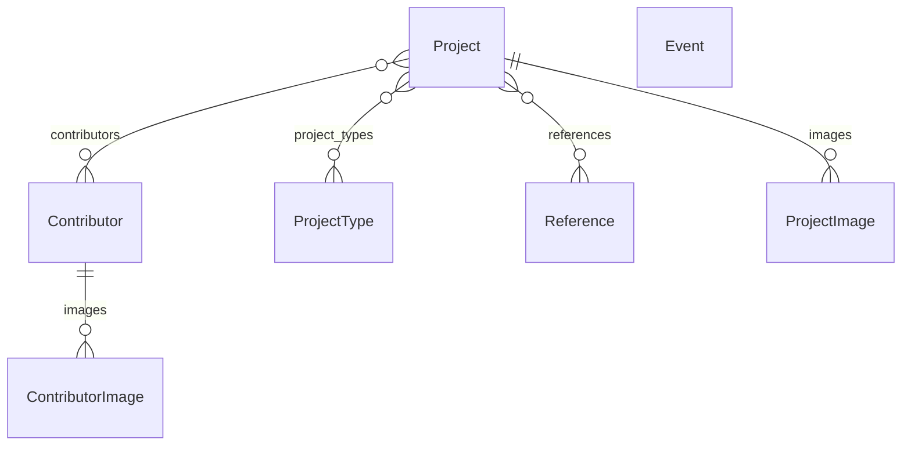

# HTS website

Sito del collettivo (Holistic Technology Salon): archivio dei progetti, contributor, eventi, pagina di
referenze/bibliografia e una pubblicazione statica su un sottodominio dedicato.

Stack: **Django 5.2**, **Postgres**, **WhiteNoise** per i file statici, **Gunicorn** per la produzione.
Il deploy previsto è su **Railway** (non ancora fatto, vedi [Deploy](#deploy-checklist)).

> Stato attuale: Bootstrap è collegato e la navbar è responsive, ma il design vero (layout editoriale, colori,
> tipografia) è ancora da fare: le pagine hanno l'aspetto di base di Bootstrap. Vedi [Frontend](#frontend-bootstrap).

## Struttura del repository

```
HTS_website/
├── README.md
├── .gitignore
├── env/                          # virtualenv (non versionato)
└── hts_website/                  # radice del progetto Django (qui c'è manage.py)
    ├── manage.py
    ├── requirements.txt
    ├── .env                      # variabili d'ambiente locali (non versionato)
    ├── .env.example              # modello di .env, elenca le variabili richieste
    ├── hts_website/              # configurazione: settings.py, urls.py, wsgi.py
    ├── portfolio/                # l'unica app: modelli, view, admin, template, test
    │   ├── models.py             # dati (leggere prima il docstring in cima)
    │   ├── views.py              # una view per pagina, con docstring
    │   ├── urls.py               # indirizzi delle pagine
    │   ├── admin.py              # configurazione dell'admin
    │   ├── embeds.py             # da link YouTube/SoundCloud a indirizzi di embed (e validazione)
    │   ├── middleware.py         # serve la pubblicazione sul sottodominio
    │   ├── context_processors.py # rende PUBLICATION_URL disponibile ai template
    │   ├── templates/portfolio/  # base.html + una pagina per file
    │   ├── migrations/           # storia dello schema del database
    │   └── tests.py
    ├── publication/              # la pubblicazione statica (index.html + publication.css + images/)
    ├── static/                   # file statici del sito
    │   ├── css/custom.css        # lo stile personale, caricato dopo Bootstrap
    │   ├── audio/intro.mp3       # suono dell'intro animato (15 s)
    │   ├── fonts/trial/          # font in versione trial (ignorata da git, vedi Frontend)
    │   ├── js/                   # gallery.js (modale immagini), players.js (player), intro.js (intro animato)
    │   └── vendor/bootstrap/     # Bootstrap 5.3.8, copia locale (non si modifica)
    └── media/                    # immagini caricate dall'admin (non versionata)
```

## Avviare il sito in locale

Servono Python 3.11 e un server Postgres con un database vuoto (si può creare da pgAdmin 4).

```bash
# dalla radice del repository
python3.11 -m venv env            # solo la prima volta
source env/bin/activate
pip install -r hts_website/requirements.txt

cd hts_website
cp .env.example .env              # solo la prima volta, poi compilare i valori
python manage.py migrate          # crea le tabelle
python manage.py createsuperuser  # utente per entrare in /admin/
python manage.py runserver
```

- Sito: <http://localhost:8000> · Admin: <http://localhost:8000/admin/>
- Pubblicazione: <http://publication.localhost:8000> (i sottodomini `*.localhost` funzionano senza configurare nulla)
- Per vedere il link "Publication" in navbar, nel `.env` imposta `PUBLICATION_URL=http://publication.localhost:8000`

### Variabili d'ambiente

Vengono lette da `hts_website/.env` (in produzione dall'ambiente). Il modello è `.env.example`.

| Variabile | Obbligatoria | Significato |
|---|---|---|
| `SECRET_KEY` | sì | Chiave segreta di Django. Senza, il sito non parte. |
| `DEBUG` | no | `True` solo in sviluppo. Se manca vale `False`. |
| `PUBLICATION_URL` | no | Indirizzo della pubblicazione per il link in navbar. Vuoto = link nascosto. |
| `PGDATABASE`, `PGUSER`, `PGPASSWORD`, `PGHOST`, `PGPORT` | sì | Connessione a Postgres. |

## Dati: come sono collegati



- **Project**: titolo, data, descrizione, una o più tipologie, contributor, immagini, e due link facoltativi
  (`youtube_url`, `soundcloud_url`) mostrati come player incorporati. `project_category` esiste
  ma oggi non è usata nelle pagine pubbliche (tenuta per il futuro).
- **ProjectType**: tipologie create dall'admin (es. "event", "radio show"). Una tipologia in uso non si può cancellare.
- **Contributor**: persone, con bio e immagini. I loro progetti si vedono nella pagina del contributor.
- **Reference**: voci della bibliografia (libro, video, immagine, link), opzionalmente collegate a progetti.
- **Event**: eventi, indipendenti dal resto. Futuro o passato si decide al volo confrontando la data con oggi.

Chi modifica cosa nell'admin (le relazioni many-to-many si modificano da **un solo lato**, l'altro è in sola lettura):

| Relazione | Si modifica da | Si vede (sola lettura) da |
|---|---|---|
| Project ↔ Contributor | admin del Project | admin del Contributor |
| Project ↔ Reference | admin della Reference | admin del Project |
| Project ↔ ProjectType | admin del Project | — |

## Pagine

| Indirizzo | View | Cosa fa |
|---|---|---|
| `/` | `home` | Home (vuota per ora) |
| `/projects/` | `project_list` | Archivio: tabella con ordinamento (`?sort=`) e filtro per tipologia (`?type=`) |
| `/projects/feed/` | `project_feed` | Tutti i progetti uno dopo l'altro, con i player YouTube/SoundCloud |
| `/projects/<id>/` | `project_detail` | Non ha pagina propria: reindirizza al feed, scrollato su quel progetto |
| `/contributors/`, `/contributors/<id>/` | `contributor_*` | Elenco e dettaglio dei contributor |
| `/events/` | `event_list` | Eventi futuri e passati in due sezioni |
| `/references/` | `reference_list` | Referenze, filtro per tipo (`?kind=`) |
| `/about/` | `about` | Pagina About (testo scritto direttamente nel template `about.html`) |
| `publication.<dominio>` | `PublicationMiddleware` | La pubblicazione statica (vedi sotto) |

## Frontend (Bootstrap)

Il sito usa **Bootstrap 5.3.8**, copiato in `hts_website/static/vendor/bootstrap/` invece di caricarlo da un CDN:
niente dipendenze esterne e nessun indirizzo IP dei visitatori inviato a terzi. Come aggiornarlo è scritto nel
README di quella cartella.

- **Dove si collega**: `templates/portfolio/base.html`, che tutte le pagine estendono. Carica prima il CSS di Bootstrap
  e poi `static/css/custom.css`; **l'ordine conta**, perché così le regole personali vincono. Il JavaScript di
  Bootstrap è in fondo alla pagina (serve alla navbar, che è sempre collassata dietro "Menu").
- **Struttura base**: navbar Bootstrap fissa in cima e sempre collassata (nessun `navbar-expand-*`: le voci si aprono in
  un box "liquid glass", vedi `custom.css`) e contenuto in un `<main class="container">`. Le pagine
  interne non usano ancora la griglia a colonne (`row`/`col-*`): è il lavoro di design da fare, pagina per pagina.
- **Come sovrascrivere Bootstrap**: le istruzioni sono in cima a `static/css/custom.css`. In breve: ridefinire le
  variabili `--bs-*` su `:root`, poi le variabili dei singoli componenti, poi regole normali; niente `!important`.
  Breakpoint e larghezze massime dei `.container` sono fissi nel file compilato: per cambiarli davvero servirebbe
  ricompilare Bootstrap con Sass, che oggi non è configurato (richiederebbe Node nel progetto).
- **I file statici**: in sviluppo li serve Django; in produzione `collectstatic` li raccoglie e li serve WhiteNoise.
  Si usano nei template con `` e ``.
- **Font**: PP Neue Machina in versione **trial**, in `hts_website/static/fonts/trial/` (12 file OTF: famiglie
  Plain e Inktrap, ciascuna in Light/Regular/Ultrabold con i corsivi). La cartella è nel `.gitignore` perché la
  licenza di prova non permette di distribuire i file: **chi clona il repository, o il sito pubblicato, non li ha**
  e vede il carattere di riserva (`sans-serif`). Le `@font-face` sono in cima a `custom.css`: "Machina Plain" per
  il testo (`--bs-body-font-family`) e "Machina Inktrap" per i titoli (Bootstrap non ha una variabile per i titoli,
  quindi c'è una regola su `h1…h6`). Nel trial mancano solo ▲ ▼ (frecce di ordinamento): usano il carattere di riserva.
  **Con la licenza**: mettere i file (meglio WOFF2, se la licenza permette la conversione) in `static/fonts/`,
  aggiornare gli `url()` in `custom.css` e togliere la riga dal `.gitignore` solo se la licenza consente di versionarli
  (in un repository pubblico di solito no).
- **Tema scuro**: l'attributo `data-bs-theme="dark"` sul tag `<html>` fa cambiare a Bootstrap molte variabili insieme
  (colore del testo, icona della navbar, ecc.). Sta in `base.html` e anche nella pubblicazione.
- **La pubblicazione** ha uno stile tutto suo: `publication/publication.css`, che **non usa Bootstrap né `custom.css`**.
  Cambiare uno non tocca l'altro. Tutto ciò che si regola (colori, caratteri, corpi, larghezza della colonna, spazi, filetti)
  è in un blocco di variabili `--pub-...` in cima al file, a gruppi e commentate: per cambiare l'aspetto si cambiano
  i valori, le regole sotto non servono. In comune col sito restano solo il viola e i font Machina (trial): i loro
  `@font-face` sono ripetuti in `publication.css` con percorsi `/static/fonts/trial/...` (`/static/` è servito anche dal
  sottodominio). Il testo lungo è in Alegreya, caricata da Google Fonts nel `<head>` di `index.html` (con corsivo e
  grassetto veri: come per il sito, da scaricare in locale quando si autorizzerà).

## Cose non ovvie da sapere

**Archivio, ordinamento e filtro.** Sono nell'indirizzo (`?sort=-date&type=event`). La view accetta solo `title` e
`date` per l'ordinamento (lista bianca, perché il valore va in `order_by`). La colonna Type non è ordinabile perché
un progetto può avere più tipologie.

**`/projects/<id>/` e il feed.** Cliccando un progetto nell'archivio si va al feed già scrollato su di lui:
`project_detail` fa un redirect a `/projects/feed/#project-<id>` e il browser scrolla da solo all'elemento con
quell'`id`. Se cambi gli `id` nel template `_project.html`, rompi lo scroll.
Perché l'ancora atterri giusta, le immagini del feed devono avere `width` e `height` nell'``: sono `loading="lazy"`
e, senza dimensioni, occupano 0 px finché non si caricano, poi spingono in basso i progetti sotto (scarto diverso per
ogni progetto). `ProjectImage` salva le dimensioni da solo (`image_width`, `image_height`); per le immagini caricate
prima della migration 0014 si riempiono con `pi.save()` su ogni `ProjectImage`. Qualsiasi altro elemento di altezza
variabile messo nel feed (player, immagini) deve riservare il suo spazio allo stesso modo.

**Player YouTube e SoundCloud.** Nell'admin del progetto si incolla il link normale (quello della barra del browser
o di "Condividi"), mai codice HTML. `portfolio/embeds.py` riconosce il servizio, ricava l'indirizzo di embed e accetta
solo YouTube e SoundCloud: l'indirizzo finisce in un `<iframe>` e non deve poter puntare a un sito qualsiasi. I
player compaiono solo nel feed dei progetti (`_project.html`, incluso da `project_feed.html`) e sono custom:
comportamento in `static/js/players.js`, aspetto in `custom.css` (sezione "Player YouTube e SoundCloud").

- **YouTube**: finché non si preme play c'è solo una copertina (`hqdefault.jpg` da `i.ytimg.com`, indirizzo da
  `youtube_thumbnail_url`) con un'etichetta "Play"; nessun iframe e nessuno script di Google. Al clic `players.js` crea
  l'`<iframe>` da `data-embed-url` con `autoplay=1`. Senza JavaScript la copertina è un normale link al video. I parametri
  in `YOUTUBE_PARAMS` (`embeds.py`) valgono ancora, dopo il clic. Per YouTube si usa `youtube-nocookie.com`.
- **SoundCloud**: il widget ufficiale è un iframe nascosto (`.sc-engine`) che fa solo da motore audio; play/pausa, barra
  e tempo sono nostri e lo pilotano con la Widget API (`https://w.soundcloud.com/player/api.js`, caricata da `players.js`
  solo se nella pagina c'è un player). Titolo e artista arrivano dal widget: sono l'attribuzione richiesta da SoundCloud,
  non vanno tolti. Il widget si carica solo quando il player sta per entrare nello schermo e un solo brano suona alla volta.
  Il widget di SoundCloud può impostare cookie già al caricamento: se il sito avrà un banner di consenso, va considerato.
  Dei parametri di `SOUNDCLOUD_PARAMS` oggi conta poco: l'interfaccia ufficiale non si vede.
- **Da verificare su iPhone**: Safari iOS può rifiutare il `play()` dato da JavaScript al widget di SoundCloud (gli serve
  un gesto dentro l'iframe). Provato solo su desktop.

**Intro animato della homepage.** Sulla homepage (solo lì) appare uno strato nero a tutto schermo: "welcome to HTS", un
clic fa partire il suono di un modem 56k (`static/audio/intro.mp3`, 15 secondi), il testo sparisce, tre linee disegnano il
triskele e una dissolvenza porta alla pagina. Dura quanto l'audio, dal clic in poi.
- **Si accende e si spegne** dall'admin: **Site settings** (un solo record, `SiteSettings` in `models.py`; spento di default).
- **Audio come blob**: `intro.js` scarica il file e lo dà al player come blob, perché Safari non riproduce un audio che il server non sa servire a pezzi (HTTP Range) e il server di sviluppo di Django non lo sa fare.
- **Perché serve il clic**: i browser non fanno partire l'audio senza un gesto della persona (su iPhone mai). Il clic sul testo
  sblocca l'audio. Se l'audio non parte comunque, la sequenza va avanti senza suono.
- **Una volta per sessione del browser** (`sessionStorage`, chiave `htsIntroSeen`), e **mai** con "riduci movimento" attivo.
  Il tasto **Skip** (o Esc) lo chiude subito e ferma l'audio. Mentre dura, il resto della pagina non è cliccabile (`inert`).
- **Dove sta**: markup in `portfolio/_intro.html` (il triskele è `triskele.svg` con `pathLength="1"`: si disegna con
  `stroke-dashoffset`, come il trim paths di After Effects), comportamento e **tempi** in `static/js/intro.js` (oggetto
  `TIMELINE` in cima), aspetto in `custom.css` (sezione "Intro animato": colori, spessore, dimensioni, in variabili `--intro-...`).
- **Rete di sicurezza**: senza JavaScript lo strato non compare; se `intro.js` non parte, sparisce da solo dopo 4 secondi.
- **Audio**: ritagliato da un video YouTube ("The Sound of dial-up Internet", William Termini, licenza YouTube standard):
  **prima di pubblicare il sito va verificato il diritto d'uso**, o sostituito con una registrazione libera (stesso
  nome di file e stessa durata, o cambiare `fallbackDuration` in `intro.js`). Se si cambia la durata dell'audio i tempi si adattano.
- Non provato su iPhone/Safari: lì il comportamento dell'audio è il più delicato.

**Cancellare una tipologia.** Per una many-to-many Django non ha `on_delete=PROTECT`: senza protezione
cancellerebbe in silenzio i collegamenti con i progetti. Per questo `ProjectTypeAdmin` (in `admin.py`) elenca i
progetti collegati come "protetti" e non mostra il pulsante di conferma. Funziona dall'admin, non da `manage.py shell`.

**La pubblicazione sul sottodominio.** `PublicationMiddleware` guarda l'host della richiesta: se inizia per
`publication.` serve i file di `hts_website/publication/` (con `index.html` per le cartelle) e risponde 404 a tutto il
resto, `/admin/` compreso. Per gli altri host non fa nulla. Con `DEBUG=True` le modifiche ai file si vedono subito;
in produzione l'elenco dei file è fissato all'avvio, quindi dopo ogni modifica serve un nuovo deploy.
La pubblicazione è una pagina unica: titolo, indice e tre sezioni (`<article id="...">`: Introduction, How to read, In
Search of Holistic Methods, quest'ultima con la bibliografia "Works Cited" in fondo), con link ad ancore (`#slug`).
Il contenuto è la conversione di un file markdown (`pubblicazione.md`, non nel repository): da ora `index.html` si
modifica a mano. **Le note**: i 21 numeri in apice nel testo (classe `pub-fnref`) sono link a un elenco
"Notes" in fondo al saggio, prima di "Works Cited" (`<li id="fn-N">`, con freccia di ritorno a `id="fnref-N"`). **Il testo
delle note è finto (lorem ipsum)**: nel markdown non c'era, e il capitolo è solo un campione. Le immagini usate stanno in `publication/images/`; dei file immagine ricevuti insieme al markdown
sono state copiate solo quelle citate nel testo.

**Immagini caricate.** Finiscono in `hts_website/media/`, cartella ignorata da git: chi clona il repository non le
riceve, e se servono vanno salvate a parte. In sviluppo le serve Django. In produzione non funzionerà così:
vedi la checklist.

**Migration scritte a mano.** `0009_copy_project_type_to_project_types.py` è una migration dei dati, commentata:
fa parte della sequenza 0008-0010 che ha sostituito il vecchio campo `project_type` con la many-to-many.

**Refuso nelle categorie.** In `Project.CATEGORIES` il valore è `"cogniton"` (probabile refuso di "cognition"). Se lo
correggi serve una migration dei dati per aggiornare i progetti già salvati con il vecchio valore.

## Operazioni comuni

```bash
# dopo aver modificato models.py
python manage.py makemigrations
python manage.py migrate

# test (crea e poi cancella un database temporaneo test_<nome>)
python manage.py test portfolio

# controllo rapido della configurazione
python manage.py check
```

- **Aggiungere una tipologia di progetto**: admin → Project types (lo slug si compila da solo).
- **Aggiornare la pubblicazione**: modifica `hts_website/publication/index.html` (istruzioni in un commento in cima al file); per l'aspetto, i valori in cima a `publication/publication.css`.
- **Cambiare il nome di una pagina in `urls.py`**: aggiorna anche i `` nei template che lo usano.

## Deploy su Railway

Il repository è pronto per il deploy: la configurazione sta in `hts_website/railway.json` (comandi di avvio), nelle
impostazioni lette dall'ambiente (`settings.py`) e nel file `.python-version`. **Provato in locale** simulando la
produzione (DEBUG spento, HTTPS dietro proxy, Gunicorn, WhiteNoise, login dell'admin con CSRF); **non ancora provato su Railway**:
`railway.json` è scritto sullo schema di Railway senza averlo potuto verificare lì, quindi al primo deploy controlla
Settings del servizio -> Deploy: se i comandi non risultano, vanno incollati a mano (sono quelli del file).

**Cosa succede a ogni deploy.** Prima di avviare la nuova versione: `python manage.py migrate --noinput` (aggiorna il
database; crea anche il gruppo *Authors*) e `python manage.py ensure_superuser` (crea il superuser dalle variabili
d'ambiente se non esiste; se esiste non tocca nulla). Avvio: `collectstatic` e Gunicorn.

**Variabili d'ambiente del servizio web** (Railway -> servizio -> Variables):

| Variabile | Valore |
|---|---|
| `SECRET_KEY` | stringa lunga e casuale (`python -c "import secrets; print(secrets.token_urlsafe(50))"`) |
| `PGHOST`, `PGPORT`, `PGUSER`, `PGPASSWORD`, `PGDATABASE` | riferimenti al servizio Postgres di Railway: `${{Postgres.PGHOST}}` ecc. |
| `NOINDEX` | `True` finché il sito non è pronto (i motori di ricerca non lo indicizzano) |
| `R2_BUCKET_NAME`, `R2_ACCOUNT_ID`, `R2_ACCESS_KEY_ID`, `R2_SECRET_ACCESS_KEY`, `R2_PUBLIC_DOMAIN` | storage delle immagini (vedi sotto) |
| `DJANGO_SUPERUSER_USERNAME`, `DJANGO_SUPERUSER_PASSWORD`, `DJANGO_SUPERUSER_EMAIL` | il tuo account admin. Dopo il primo deploy la password si cambia dall'admin; quella nella variabile non serve più |
| `DEBUG` | **non impostarla** (vale False) |
| `ALLOWED_HOSTS` | non serve con l'indirizzo gratuito (`RAILWAY_PUBLIC_DOMAIN` lo imposta Railway); con il dominio vero: `dominio.it,www.dominio.it,publication.dominio.it` |
| `PUBLICATION_URL` | vuota finché non c'è il dominio (il link "Publication" resta nascosto) |

**Passi, in ordine**
1. **GitHub**: pubblicare i commit (`git push`). Il repository non contiene segreti né i font trial.
2. **Cloudflare R2** (immagini): R2 -> Create bucket -> nel bucket Settings -> attivare l'accesso pubblico (dominio `r2.dev`, che diventa
   `R2_PUBLIC_DOMAIN`, senza `https://`) -> "Manage R2 API tokens" -> Create token con permesso *Object Read & Write* sul solo bucket.
   Si ottengono Account ID, Access Key ID e Secret Access Key. Il bucket ha un CORS di default che basta (le immagini si caricano dall'admin sul server, non dal browser).
3. **Railway**: New Project -> Deploy from GitHub repo -> servizio -> Settings -> **Root Directory: `hts_website`**. Add -> Database -> PostgreSQL.
   Inserire le variabili della tabella sopra. Settings -> Networking -> **Generate Domain** (indirizzo `*.up.railway.app`) e rifare il deploy:
   fino ad allora il sito risponde 400 perché non conosce il proprio indirizzo.
4. **Primo accesso**: `https://<indirizzo>/admin/` con le credenziali delle variabili. In *Site settings* si accende o spegne l'intro
   animato (online parte **spento**: il suo audio ha una licenza da verificare).
5. **Autori**: Users -> Add user (nome e password), poi nella scheda dell'utente spuntare **Staff status** e aggiungerlo al gruppo **Authors**.
   Gli autori gestiscono progetti, contributor, eventi, referenze, tipologie e immagini; non vedono utenti, gruppi né Site settings.
   **Mai** spuntare "Superuser status" agli autori.

**Cose da sapere**
- **Database online = quello vero.** Non si copia sopra il database locale (contiene dati di prova). Le migrazioni si applicano a ogni deploy:
  conviene che le modifiche ai modelli siano *additive* (aggiungere campi con valore predefinito o facoltativi); per rinominare o togliere un campo, prima un backup.
- **Immagini**: finiscono su R2 e non si perdono ai deploy. Senza le variabili `R2_*`, online le immagini non si vedrebbero (con DEBUG spento Django non serve `media/`).
  Le immagini nel `media/` locale non vengono caricate online.
- **Font**: online mancano i font Machina (trial, ignorati da git): sito e pubblicazione usano il carattere di riserva.
- **Pubblicazione**: vive su `publication.<dominio>`; con l'indirizzo gratuito di Railway non è raggiungibile (l'host `publication.*.up.railway.app` non è ammesso).
- **Backup**: i dati sono nel Postgres di Railway: controllare nel suo pannello le opzioni di backup prima di affidargli contenuti importanti.

**Quando ci sarà il dominio**
- [ ] Collegare in Railway il dominio principale e `publication.<dominio>` allo stesso servizio (controllare il limite di domini del piano) e configurare il DNS.
- [ ] `ALLOWED_HOSTS` con i tre indirizzi e `PUBLICATION_URL=https://publication.<dominio>`.
- [ ] Attivare HSTS (`SECURE_HSTS_SECONDS`, prima con valore basso) solo col dominio definitivo; `check --deploy` lo segnala finché manca.
- [ ] Valutare un dominio proprio per le immagini (es. `media.<dominio>`) al posto di `r2.dev`: se cambia, `R2_PUBLIC_DOMAIN` si aggiorna, ma gli indirizzi delle immagini già salvate restano quelli vecchi se il bucket resta lo stesso.
- [ ] Con i font veri (licenza) nel repository, passare a `CompressedManifestStaticFilesStorage` in `settings.py` (nomi dei file con impronta: risolve la cache dei browser).
- [ ] Spegnere `NOINDEX` quando il sito è pronto.
- [ ] Verificare i diritti dell'audio dell'intro prima di accenderlo online.

## Idee rimandate

- **Design**: layout editoriale, colori e tipografia da definire in `static/css/custom.css`, adattando le pagine alla
  griglia di Bootstrap. Restano alcuni `style=` inline temporanei (larghezza immagini, margini) e le classi `active`
  dei filtri non hanno ancora uno stile.
- **Zotero** per la bibliografia: valutato e per ora scartato; le referenze si inseriscono dall'admin.
- **Video incorporati** (YouTube/Vimeo) nelle referenze: oggi i video sono solo un link.
- **Dati di prova**: il database locale contiene referenze di esempio e la pubblicazione contiene testi fittizi.
